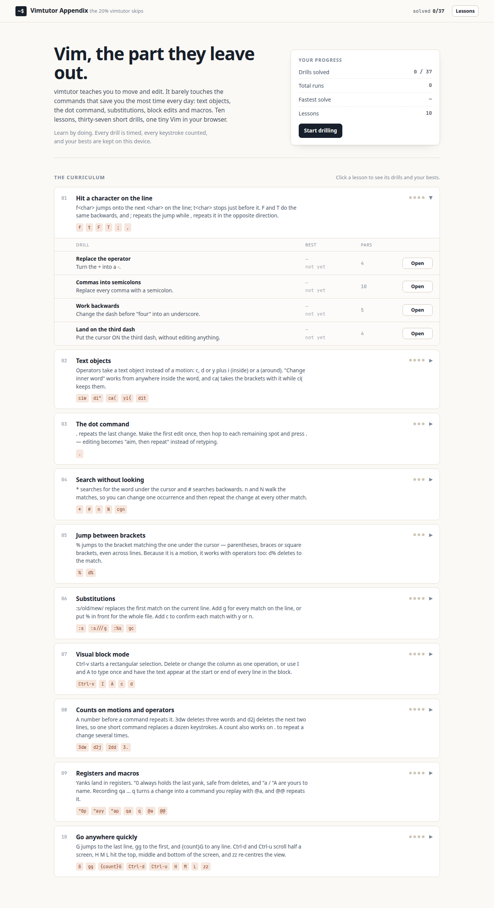

# Vimtutor Appendix

A companion to `vimtutor`: hands-on drills for the high-value Vim skills that `vimtutor` does not
practise. Ten short lessons, thirty-seven drills, one small Vim in your browser. No backend, no
accounts, no sign-in — your bests live in `localStorage`.

**[Play it here](https://lcul123.github.io/vimtutor-appendix/)** (after you enable Pages — see below).



## What it is

`vimtutor` is a great first hour: it teaches you to move around, insert text, delete lines, and
save. What it leaves out is the material that decides whether Vim feels fast or feels like a
chore — text objects, the dot command, substitutions, visual block, counts, registers and
macros. Those are the commands you use dozens of times a day, and they are the ones most people
never learn because nothing ever made them practise.

This app is that practice. Each lesson is a few lines of explanation and 2–4 escalating drills.
Every drill gives you a starting buffer and a target buffer (or a cursor target). You solve it in
a real Vim-like editor; the drill completes the instant the buffer matches. The timer starts on
your first keystroke and stops when you solve it, keystrokes are counted, and your best time and
best keystroke count per drill are stored locally so you can grind a drill until it is muscle
memory.

## Why these lessons (and not others)

`vimtutor` covers: modes, basic movement (`h j k l w b e 0 $`), insert and append, `x`/`dd`,
`p`, `u`/`U`/`Ctrl-r`, `r`, `c`, `ce`, `y`/`p`, search with `/`, `%` (briefly), `:s` (briefly),
and `:w`/`:q`.

It barely drills, or skips entirely, everything below. Each item was chosen for daily payoff
rather than completeness, and each is a *skill* rather than a fact to memorise:

| Lesson | Why it earns a slot |
| --- | --- |
| `f` `t` `F` `T` with `;` `,` | Reach an exact character in two keys instead of arrow-keying. |
| Text objects (`ciw`, `di"`, `ca(`, `yi{`, `dit`) | Edit *by structure* so the edit is the same size regardless of the content. |
| The dot command | Turns "make an edit" into "aim, then repeat" — the single biggest speed multiplier. |
| `*` `#` `n` `N` and `cgn` | Jump to what you mean and rename every occurrence without a regex. |
| `%` | One key to the other end of a bracket, across lines, and a motion for operators. |
| `:s`, `:%s`, `g`, `c` | Whole-file edits without opening an external tool. |
| Visual block (`Ctrl-v`) | Column edits, and `I`/`A` inserting on many lines at once. |
| Counts (`3dw`, `d2j`, `2dd`, `3.`) | One short command instead of a dozen keys. |
| Registers (`"0`, `"a`, `"A`) and macros (`qa`, `@a`, `@@`) | Automate the third repetition onwards. |
| `gg` `G` `{count}G` `Ctrl-d` `Ctrl-u` `H` `M` `L` `zz` | Get to a place in a file in one or two keys. |

Deliberately skipped: marks, folds, `:g/`, window and tab management, mappings and plugins,
`v:count`, `gv`, and the rest of the long tail. They are useful eventually, but they are either
memorisation-heavy or situational, and they would dilute the 80/20.

## Lesson list

1. **Hit a character on the line** — `f` `t` `F` `T` `;` `,` (4 drills)
2. **Text objects** — `ciw` `di"` `ca(` `yi{` `dit` (4)
3. **The dot command** — `.` (3)
4. **Search without looking** — `*` `#` `n` `N` `cgn` (3)
5. **Jump between brackets** — `%` `d%` (3)
6. **Substitutions** — `:s` `:s///g` `:%s` `gc` (4)
7. **Visual block mode** — `Ctrl-v` `I` `A` `c` `d` (4)
8. **Counts on motions and operators** — `3dw` `d2j` `2dd` `3.` (4)
9. **Registers and macros** — `"0p` `"ayy` `"ap` `qa` `q` `@a` `@@` (4)
10. **Go anywhere quickly** — `G` `gg` `{count}G` `Ctrl-d` `Ctrl-u` `H` `M` `L` `zz` (4)

## Run it locally

Requires Node 20 or newer (developed on Node 22).

```bash
npm install
npm run dev        # http://localhost:5173
```

Build a static site into `dist/`:

```bash
npm run build
npm run preview    # serve dist/ locally
```

`dist/` is plain HTML/CSS/JS with relative asset paths, so it can be dropped on any static host.

## How to play

1. Open the app and click **Start drilling** (or pick any lesson).
2. Read the one-line goal, then solve it in the left-hand buffer. The right-hand panel is the
   target: lines still needing work are highlighted.
3. The clock starts on your first keystroke and stops when the buffer matches. **Esc** gets you
   back to normal mode like real Vim.
4. Your time and keystroke count are recorded. A new record is celebrated in the green banner;
   the **Best** box and the lesson table always show your records.
5. **Retry** (button, or `Ctrl` + `Enter`) resets instantly so you can grind for a better time.
   `Ctrl` + `Shift` + `Enter` jumps to the next drill. **Hint** reveals the intended approach, and
   **Par** is the keystroke count of an efficient solution.

Everything is keyboard-first: once the editor has focus you never need the mouse.

## Tests

```bash
npm test          # unit tests (Vitest + jsdom)
npm run test:e2e  # browser tests (Playwright, real Chromium)
```

`npm test` covers the drill engine: buffer matching and normalisation, the line diff, the
stopwatch (start-on-first-key, freeze-on-solve, injected clock), record and personal-best logic
(including independent time/key bests and corrupt-storage recovery), `localStorage` round-tripping,
and drill-session behaviour. `npm run test:e2e` builds the site,
serves it, and then **replays every drill's reference solution in a real browser** against the
same editor and emulator the app ships. That is the test that keeps the curriculum honest. It
also covers timing, records, retry, persistence across reloads, and navigation.

The first e2e run needs browsers once:

```bash
npx playwright install chromium
```

CI runs both suites on every pull request (`.github/workflows/ci.yml`).

## Deploying to GitHub Pages

A workflow is included at `.github/workflows/deploy.yml`; it runs the unit tests, builds, and
publishes `dist/` on every push to `main`.

To enable it:

1. Push this repository to GitHub (public).
2. Go to **Settings → Pages**.
3. Under **Build and deployment → Source**, choose **GitHub Actions**.
4. Push to `main` (or run the workflow manually from the **Actions** tab).

The site will appear at `https://<user>.github.io/<repo>/`. `vite.config.ts` sets
`base: './'`, so it works from a subpath without further configuration.

## Emulator notes

The editor is [CodeMirror 6](https://codemirror.net/) with
[`@replit/codemirror-vim`](https://github.com/replit/codemirror-vim). It is genuinely Vim-like,
but it is not Vim, and a few things needed working around. Each of these is documented in
`src/engine/session.ts` and enforced by tests:

- **Ctrl-v needs `EditorState.allowMultipleSelections`.** The adapter models a blockwise selection
  as several selection ranges. Without that facet CodeMirror silently keeps only the first range,
  so block `d`/`c`/`I`/`A` appear to do almost nothing. With it, all four block drills work.
- **`cit`/`dit` need a syntax tree.** Tag objects resolve through the HTML parser, so the editor
  enables `@codemirror/lang-html`; otherwise `dit` inside `<div>…</div>` is a no-op.
- **Don't call `Vim.enterVimMode()` yourself.** The `vim()` extension already enters Vim mode.
  Calling it a second time breaks insert-change recording, so `.` and macros replay only the last
  character of an insert. Removing the duplicate call fixed it.
- **Don't add `defaultKeymap`.** It binds `Ctrl-a` to `cursorLineStart`, which swallows Vim's
  `Ctrl-a` increment. Vim ships its own normal- and insert-mode bindings, so the drill editor uses
  `vim()` plus `history()` only.
- **`&` is not bound.** Repeating the last `:s` with `&` is a no-op in this emulator, so no drill
  depends on it; the substitution lesson teaches `:s///g`, `:%s` and `gc` instead, and `:%s` covers
  the "apply it everywhere" case.
- **Visual block `I`/`A` insert at the block's start/end of line**, not at the exact column, when
  the selection is only one column wide. The drills target behaviour the emulator implements
  faithfully (start-of-line insert, end-of-line append, block change/delete).
- **`2.` after an insert repeats the insert twice on the same line** (matching Vim), so the
  count-and-dot drill uses a delete instead of an append.

## Project layout

```
src/
  app/            React UI: overview, drill page, records hook
  content/        The curriculum (lessons + drills + reference solutions)
  engine/         Buffer matching, diff, records/personal bests, drill session
tests/            Vitest unit tests
tests/e2e/        Playwright browser tests, including every drill's solution
```

## License

MIT. See `LICENSE`.
