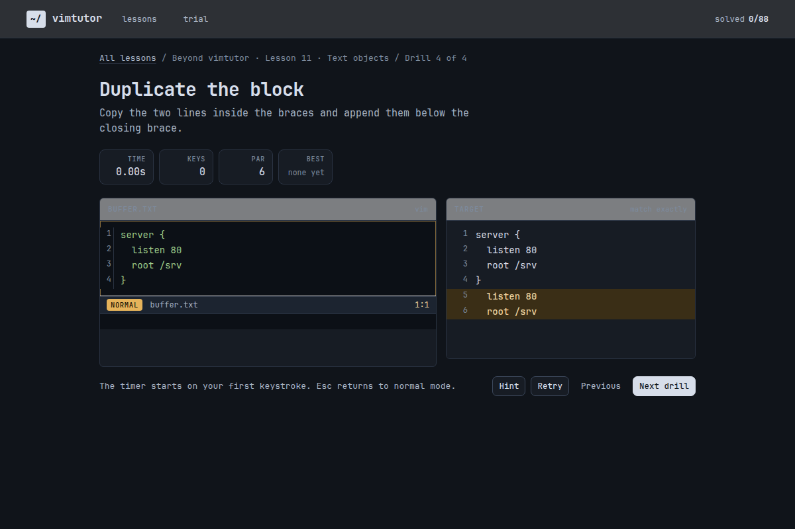
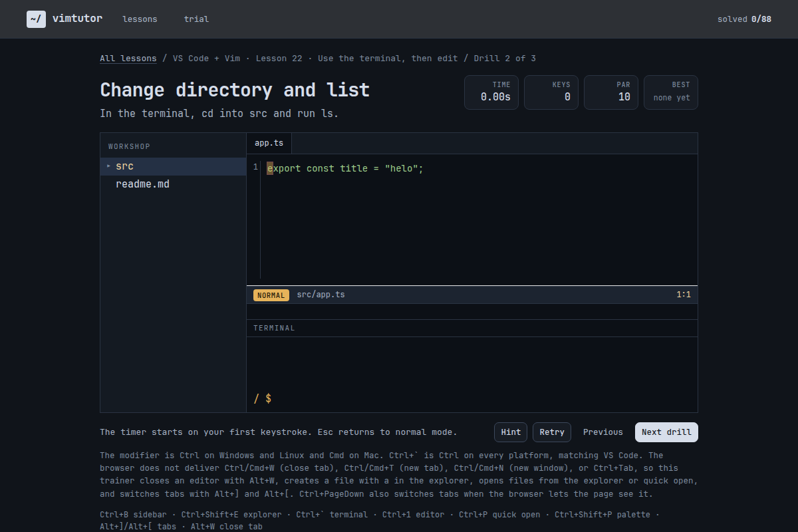
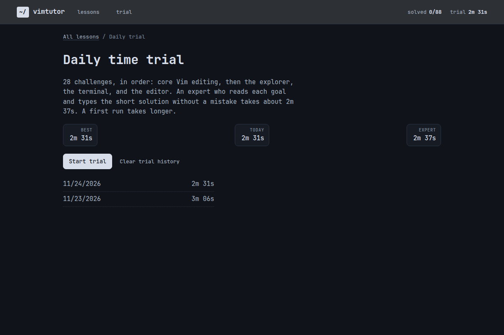
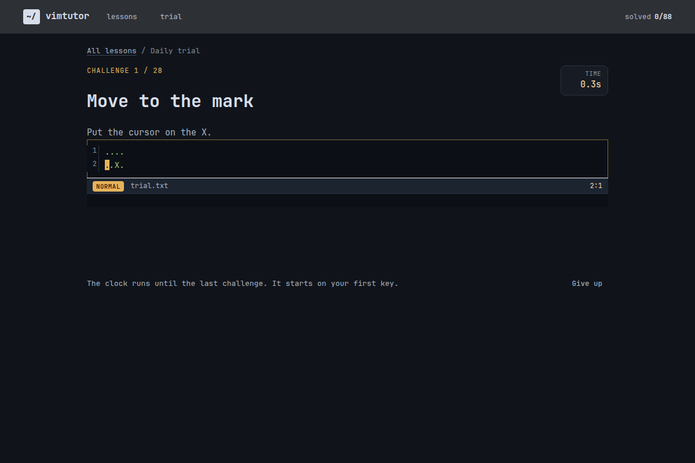

# Vimtutor Appendix

A terminal in the browser for learning Vim the way it is actually used: the vimtutor core, the
commands vimtutor leaves out, and the VS Code layout around the Vim extension. No backend, no
accounts, no sign-in. Bests and the daily trial live in `localStorage`.

**[Play it here](https://lcul123.github.io/vimtutor-appendix/)** (after you enable Pages — see below).



## What it is

The page is a dark monospace terminal. The editor has a block cursor, a Vim status line
(`NORMAL` / `INSERT` / `VISUAL`, file name, line:column) and a command line under it for `:`
commands. Drills complete on their own when the buffer, the cursor, or the workspace matches the
goal. The timer starts on the first keystroke.

Three sections:

1. **Vimtutor** — movement, insert, delete, change, undo, yank, search, substitute, and `:w`.
2. **Beyond vimtutor** — the original appendix: text objects, the dot command, macros, and the rest.
3. **VS Code + Vim** — a simulated editor: file explorer, Vim editor, integrated terminal. You move
   between them with the keyboard only.



## Why these lessons (and not others)

`vimtutor` covers: modes, basic movement (`h j k l w b e 0 $`), insert and append, `x`/`dd`,
`p`, `u`/`U`/`Ctrl-r`, `r`, `c`, `ce`, `y`/`p`, search with `/`, `%` (briefly), `:s` (briefly),
and `:w`/`:q`.

It barely drills, or skips entirely, everything below. Each item was chosen for daily payoff
rather than completeness, and each is a *skill* rather than a fact to memorise:

| Lesson | Why it earns a slot |
| --- | --- |
| `f` `t` `F` `T` with `;` `,` | Reach an exact character in two keys instead of arrow-keying. |
| Text objects (`ciw`, `di"`, `ca(`, `yi{`) | Edit *by structure* so the edit is the same size regardless of the content. |
| The dot command | Turns "make an edit" into "aim, then repeat" — the single biggest speed multiplier. |
| `*` `#` `n` `N` and `cgn` | Jump to what you mean and rename every occurrence without a regex. |
| `%` | One key to the other end of a bracket, across lines, and a motion for operators. |
| `:s`, `:%s`, `g`, `c` | Whole-file edits without opening an external tool. |
| Visual block (`Ctrl-v`) | Column edits, and `I`/`A` inserting on many lines at once. |
| Counts (`3dw`, `d2j`, `2dd`, `3.`) | One short command instead of a dozen keys. |
| Registers (`"0`, `"a`, `"A`) and macros (`qa`, `@a`, `@@`) | Automate the third repetition onwards. |
| `gg` `G` `{count}G` `Ctrl-d` `Ctrl-u` `H` `M` `L` `zz` | Get to a place in a file in one or two keys. |

The appendix still skips marks, folds, `:g/`, Vim windows, mappings, and plugins. Moving around
VS Code — sidebar, explorer, terminal, tabs — is its own section, because that is the editor the
Vim extension actually runs in.

## Lesson list

### Vimtutor

1. **Move with hjkl** — `h` `j` `k` `l`
2. **Move by words** — `w` `b` `e`
3. **Ends of the line and the file** — `0` `$` `gg` `G`
4. **Insert and append** — `i` `a` `A` `o` `O`
5. **Delete** — `x` `dw` `dd` `d3w`
6. **Change and replace** — `r` `cw` `ce` `R`
7. **Undo, yank, put, and visual** — `u` `Ctrl-r` `yy` `p` `v`
8. **Search** — `/` `?` `n` `N`
9. **Brackets, substitute, and save** — `%` `d%` `:s` `:w`

### Beyond vimtutor

10. **Hit a character on the line** — `f` `t` `F` `T` `;` `,`
11. **Text objects** — `ciw` `di"` `ca(` `yi{`
12. **The dot command** — `.`
13. **Search without looking** — `*` `#` `n` `N` `cgn`
14. **Jump between brackets** — `%` `d%`
15. **Substitutions** — `:s` `:s///g` `:%s` `gc`
16. **Visual block mode** — `Ctrl-v` `I` `A` `c` `d`
17. **Counts on motions and operators** — `3dw` `d2j` `2dd` `3.`
18. **Registers and macros** — `"0p` `"ayy` `"ap` `qa` `q` `@a` `@@`
19. **Go anywhere quickly** — `G` `gg` `{count}G` `Ctrl-d` `Ctrl-u` `H` `M` `L` `zz`

### VS Code + Vim

20. **Sidebar, editor, and terminal** — `Ctrl/Cmd+B`, `Ctrl/Cmd+Shift+E`, Ctrl+backtick, `Ctrl/Cmd+1`
21. **Navigate the explorer** — `j` `k` `h` `l` `Enter`, `a` to create, `r` to rename
22. **Use the terminal, then edit** — `pwd` `ls` `cd`, then back to the editor
23. **Quick open, palette, and tabs** — `Ctrl/Cmd+P`, `Ctrl/Cmd+Shift+P`, `Alt+]` `Alt+[` `Alt+W`

The modifier is Ctrl on Windows and Linux and Cmd on Mac. Ctrl+backtick is Ctrl on every platform,
matching VS Code. The shell is simulated (`ls`, `cd`, `pwd`, `cat`, `echo`, `clear`).

## Shortcuts the browser keeps

Chromium does not deliver some shortcuts to the page, so `preventDefault` cannot claim them.
The lessons say so, and the trainer binds a key the browser will give us:

| VS Code | What the browser does | In this trainer |
| --- | --- | --- |
| `Ctrl/Cmd+W` | Closes the browser tab | `Alt+W` closes the editor tab |
| `Ctrl/Cmd+T` | Opens a browser tab | Open a file from the explorer or with quick open |
| `Ctrl/Cmd+N` | Opens a browser window | `a` in the explorer creates a file |
| `Ctrl+Tab` | Switches browser tabs | `Alt+]` / `Alt+[` switch editor tabs |

`Ctrl+PageDown` and `Ctrl+PageUp` also switch tabs when the browser delivers them. `Ctrl-r` in
the editor is Vim's redo: the page does not call `preventDefault` on that key while focus is in
the editor, because CodeMirror ignores a key whose default is already cancelled. Vim cancels it
itself, so the browser does not reload.

## Daily time trial

A separate mode, `#/trial`. One fixed sequence of 28 challenges: the core edits, then the
explorer, the terminal, and tab switching. The clock runs from the first key to the last
challenge and shows a split after each one. Every finished run is stored on this device, with
the all-time best, today's attempt, and recent history.



Expert pace, from `src/engine/trial.ts`:

- 4.0 seconds to read each goal and find the spot
- 280ms per keystroke of the minimal solution (about 3.6 keys a second once the command is chosen)

The current sequence is 28 challenges and 161 keystrokes:

`161 × 280ms + 28 × 4.0s = 157.1s` (2m 37s).

A unit test fails if that product leaves the 2–3 minute range. A beginner spends most of the
attempt remembering the command, so the same sequence takes considerably longer. Per-challenge
splits are shown during the run.



## Run it locally

Requires Node 20 or newer (developed on Node 22).

```bash
npm install
npm run dev        # http://localhost:5173
```

Build a static site into `dist/`:

```bash
npm run build
npm run preview    # serve dist/ locally
```

`dist/` is plain HTML/CSS/JS with relative asset paths, so it can be dropped on any static host.

## How to play

1. Open the app and click **Start drilling** (or pick any lesson).
2. Read the one-line goal, then solve it in the left-hand buffer. The right-hand panel is the
   target: lines still needing work are highlighted.
3. The clock starts on your first keystroke and stops when the buffer matches. **Esc** gets you
   back to normal mode like real Vim.
4. Your time and keystroke count are recorded. A new record is celebrated in the green banner;
   the **Best** box and the lesson table always show your records.
5. **Retry** (button, or `Ctrl` + `Enter`) resets instantly so you can grind for a better time.
   `Ctrl` + `Shift` + `Enter` jumps to the next drill. **Hint** reveals the intended approach, and
   **Par** is the keystroke count of an efficient solution.

Everything is keyboard-first: once the editor has focus you never need the mouse.

## Tests

```bash
npm test          # unit tests (Vitest + jsdom)
npm run test:e2e  # browser tests (Playwright, real Chromium)
```

`npm test` covers the drill engine (buffer matching, checkpoints, `:w`, the stopwatch, records),
the workspace (explorer, shell, palette, and every VS Code drill's solution), and the trial
(expert-time estimate, history, corrupt storage). `npm run test:e2e` builds the site,
serves it, and then **replays every drill's reference solution in a real browser** against the
same editor and emulator the app ships. That is the test that keeps the curriculum honest. It
also covers timing, records, retry, the daily trial, and navigation.

The first e2e run needs browsers once:

```bash
npx playwright install chromium
```

CI runs both suites on every pull request (`.github/workflows/ci.yml`).

## Deploying to GitHub Pages

A workflow is included at `.github/workflows/deploy.yml`; it runs the unit tests, builds, and
publishes `dist/` on every push to `main`.

To enable it:

1. Push this repository to GitHub (public).
2. Go to **Settings → Pages**.
3. Under **Build and deployment → Source**, choose **GitHub Actions**.
4. Push to `main` (or run the workflow manually from the **Actions** tab).

The site will appear at `https://<user>.github.io/<repo>/`. `vite.config.ts` sets
`base: './'`, so it works from a subpath without further configuration.

## Emulator notes

The editor is [CodeMirror 6](https://codemirror.net/) with
[`@replit/codemirror-vim`](https://github.com/replit/codemirror-vim). It is genuinely Vim-like,
but it is not Vim, and a few things needed working around. Each of these is documented in
`src/engine/session.ts` and enforced by tests:

- **Ctrl-v needs `EditorState.allowMultipleSelections`.** The adapter models a blockwise selection
  as several selection ranges. Without that facet CodeMirror silently keeps only the first range,
  so block `d`/`c`/`I`/`A` appear to do almost nothing. With it, all four block drills work.
- **Don't call `Vim.enterVimMode()` yourself.** The `vim()` extension already enters Vim mode.
  Calling it a second time breaks insert-change recording, so `.` and macros replay only the last
  character of an insert. Removing the duplicate call fixed it.
- **Don't add `defaultKeymap`.** It binds `Ctrl-a` to `cursorLineStart`, which swallows Vim's
  `Ctrl-a` increment. Vim ships its own normal- and insert-mode bindings, so the drill editor uses
  `vim()` plus `history()` only.
- **`&` is not bound.** Repeating the last `:s` with `&` is a no-op in this emulator, so no drill
  depends on it; the substitution lesson teaches `:s///g`, `:%s` and `gc` instead, and `:%s` covers
  the "apply it everywhere" case.
- **Visual block `I`/`A` insert at the block's start/end of line**, not at the exact column, when
  the selection is only one column wide. The drills target behaviour the emulator implements
  faithfully (start-of-line insert, end-of-line append, block change/delete).
- **`2.` after an insert repeats the insert twice on the same line** (matching Vim), so the
  count-and-dot drill uses a delete instead of an append.
- **`Ctrl-r` must reach the editor.** CodeMirror drops a keydown whose default is already
  cancelled, so the page does not `preventDefault` `Ctrl-r` while focus is in the editor. Vim
  cancels the reload itself. Outside the editor, `Ctrl-r` is cancelled so the trial does not
  refresh the tab.

## Project layout

```
src/
  app/            React UI: overview, drill page, VS Code layout, daily trial
  content/        Core lessons, the appendix, VS Code lessons, trial sequence
  engine/         Vim session, workspace/shell, records, trial timing
tests/            Vitest unit tests
tests/e2e/        Playwright browser tests, including every drill's solution
```

## License

MIT. See `LICENSE`.
